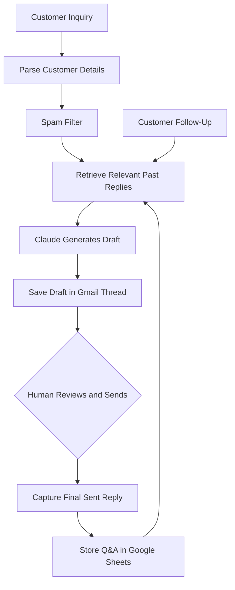

# AI Email Draft Assistant

An AI-powered email assistant that automates customer inquiry responses using historical conversations while keeping human review at the center of the process.

I built and deployed this system for GTB Entertainment, a golf simulator dealer, to reduce repetitive email work, improve response consistency, and streamline customer communication. It runs on the company's sales inbox, generating personalized Gmail drafts using relevant past conversations and learning from the responses our team actually sends.

## Project Highlights

~60% reduction in manual email response time: Automated inquiry analysis and draft generation, allowing the team to review, make minor edits, and send responses in seconds.

170+ historical customer email threads: Built a retrieval-augmented generation (RAG) pipeline that uses past customer conversations to generate context-aware responses.

Continuous knowledge base improvement: Automatically stores finalized customer replies in Google Sheets, making new interactions available for future retrieval.

Production deployment: Runs on the company's sales inbox with automated follow-ups, Gmail threading, and human approval before sending.

This repository is a cleaned-up version of the production system, with sensitive company information managed through configuration.

## Key Features

- **AI-powered email drafts:** Uses Claude to generate personalized responses based on customer inquiries and relevant past conversations.
- **Human-in-the-loop review:** Saves responses as Gmail drafts for the team to review, edit, and send.
- **Continuous feedback loop:** Captures final sent replies in Google Sheets and uses them as reference examples for future inquiries.
- **Threaded conversations:** Maintains customer follow-ups within the original Gmail thread using proper email headers.
- **Automated follow-up reminders:** Creates check-in drafts after three business days of inactivity, while checking for responses in other threads.
- **Spam filtering and error handling:** Filters suspicious inquiries, prevents duplicate drafts, and handles temporary API failures.

## System Architecture



The system uses a retrieval-augmented generation (RAG) approach to reference historical customer interactions before generating new drafts.

Instead of retraining the language model, the assistant retrieves the six most relevant question-and-answer pairs from Google Sheets using keyword matching. As the team reviews and sends new replies, those interactions are added to the database and become available for future retrieval.

## Technical Implementation

**Retrieval and feedback loop**

I designed the system to learn from the final responses the team actually sends rather than the original AI drafts. This allows future responses to reflect real customer interactions, corrections, and the team's preferred writing style.

**Gmail threading and duplicate prevention**

The assistant uses Gmail's `threadId`, `In-Reply-To`, and `References` headers to keep conversations organized. Gmail labels track processed messages, while existing-draft checks and GitHub Actions concurrency controls help prevent duplicate processing.

**Reliable data processing**

The email parser extracts customer information from website contact forms and supports multiple field-name variations through `FORM_FIELD_ALIASES`. Missing fields trigger warnings to help identify unexpected changes in incoming data.

**API efficiency and error handling**

A rule-based spam filter reduces unnecessary LLM requests. Google API calls use exponential backoff for temporary failures, while per-run caching reduces repeated requests.

## Project Impact

- **Reduced repetitive work:** Automated customer inquiry parsing, relevant response retrieval, draft generation, and follow-up preparation.
- **Improved response consistency:** Used previously reviewed customer replies to generate drafts that better reflect the team's communication style.
- **Maintained human oversight:** Required manual approval before sending customer-facing messages.
- **Created a reusable knowledge base:** Stored completed customer interactions as structured question-and-answer pairs for future reference.
- **Supported real business operations:** Deployed the system in a production sales inbox and improved reliability based on actual workflow issues.

## Challenges and Lessons Learned

Running the assistant in production helped me identify and resolve several issues that were not obvious during initial development.

- **OAuth authentication:** Resolved an `invalid_grant` error caused by a revoked Google refresh token and improved the authentication setup.
- **Changing form fields:** Updated the parser after a website form change caused missing product information in generated drafts.
- **Scheduling reliability:** Adjusted batch-processing limits after GitHub Actions scheduled workflows ran less frequently than expected.

These experiences strengthened my understanding of API integration, data quality, workflow monitoring, and maintaining reliable automation systems.

## Tech Stack

| Technology | Purpose |
|---|---|
| Python | Automation logic and data processing |
| Anthropic Claude API | AI-powered email generation |
| Gmail API | Email retrieval, threading, and draft creation |
| Google Sheets API | Conversation history and retrieval |
| GitHub Actions | Workflow scheduling and automation |

## Getting Started

**Requirements:** Python 3.11+, Google Cloud OAuth credentials with Gmail and Sheets APIs enabled, an Anthropic API key, and a Google Sheet with `Customer Message`, `Our Reply`, and `Date` columns.

Install dependencies:

```bash
pip install -r requirements.txt
```

Configure the variables listed in `.env.example`, then run:

```bash
# Preview without creating drafts
python assistant.py --dry-run

# Run one processing cycle
python assistant.py

# Run continuously with 5-minute polling
python assistant.py --loop
```

The first run opens a browser for Google authentication and saves `token.json`.

For GitHub Actions deployment, store Base64-encoded Google OAuth credentials and token data in the `GOOGLE_CREDENTIALS` and `GOOGLE_TOKEN` secrets. Add `ANTHROPIC_API_KEY` and `SHEET_ID`, and configure the remaining repository variables.

See the [GitHub Actions workflow](.github/workflows/email_assistant.yml) for the deployment configuration.

## Future Improvements

- **Draft evaluation:** Compare AI-generated drafts with final sent responses to measure editing effort, factual accuracy, and writing consistency.
- **Embedding-based retrieval:** Replace keyword matching with semantic search to identify relevant conversations more accurately.
- **Review dashboard:** Build an interface showing generated drafts, retrieved examples, and supporting context.

## What I Learned

Building this project gave me experience developing an AI automation system that operates in a real business environment. Beyond working with LLMs and APIs, I learned how to structure data for retrieval, build reliable feedback loops, troubleshoot production issues, and balance automation with human oversight.

The project reinforced my interest in using AI and data engineering to solve practical business problems.
