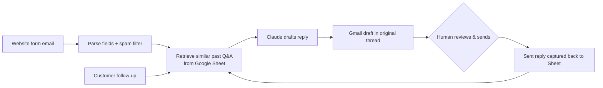

# AI Email Draft Assistant

An LLM-powered assistant that drafts replies to inbound sales inquiries in Gmail, learns from the replies the team actually sends, and keeps every customer conversation in one thread.

I built it for a golf simulator dealer, where it runs in production on the company's sales inbox. This repo is a cleaned-up copy: business names, addresses, and IDs come from configuration instead of being hard-coded.

Project Highlights

~60% reduction in manual email response time: Automated inquiry analysis and draft generation, allowing the team to review, make minor edits, and send responses in seconds.

170+ historical customer email threads: Built a retrieval-augmented generation (RAG) pipeline that uses past customer conversations to generate context-aware responses.

Continuous knowledge base improvement: Automatically stores finalized customer replies in Google Sheets, making new interactions available for future retrieval.

Production deployment: Runs on the company's sales inbox with automated follow-ups, Gmail threading, and human approval before sending.

## What it does

1. **New inquiries.** It finds website contact-form notification emails, parses the customer's details (name, location, product interest, intended use, message), filters out spam, and asks Claude to draft a reply.
2. **Human in the loop.** Replies are created as **Gmail drafts** in the customer's original thread, never sent automatically. A person reviews, edits, and sends.
3. **Learning from what was actually sent.** After the team sends a reply, the assistant saves the *real* sent text, not the AI draft, to a Google Sheet as a question/answer pair. Future drafts pull the most relevant past pairs as examples, so the drafts gradually take on the team's real voice and answers.
4. **Follow-ups.** When a customer replies, it drafts a response in the same thread with correct `In-Reply-To` / `References` headers, so Gmail keeps the whole conversation together.
5. **Reminders.** If a customer goes quiet for 3+ business days after the team's reply, it drafts a short, friendly check-in, unless that customer has already replied in another thread.



## Design decisions

- **Drafts, not auto-send.** Sales replies carry real commercial risk, so the model proposes and a person decides. The prompt also has hard rules: never quote prices, delivery dates, or ROI that the team hasn't confirmed, and ask for missing info (room size, intended use) instead of guessing.
- **Real sent replies as memory.** The feedback loop uses what humans actually sent, not what the model drafted. Every edit the team makes improves later drafts without any fine-tuning.
- **Lightweight retrieval.** Past pairs are ranked by keyword overlap with the new inquiry (top 6). It's simple, cheap, and easy to debug from logs. Embeddings would be a natural upgrade.
- **Idempotent by design.** Every handled email gets a Gmail label (`Phase2-Processed`, `Phase2-FollowupProcessed`, …). Each run also checks for an existing draft in the thread before calling the model. The label is applied right after the draft is created, before any other write, so a later failure can't cause a duplicate draft. Workflow runs are serialized with a concurrency group.
- **Status-agnostic search.** Processing is tracked by labels, never by read/unread or inbox status, so emails someone already opened or archived are still handled.
- **Form parsing that survives changes.** The website form has renamed fields more than once ("Product" → "Product Interest"). Each field accepts a list of label variants (`FORM_FIELD_ALIASES`). New inquiries log a warning when a key field is missing, so a form change shows up in the logs instead of silently degrading draft quality.
- **Rule-based spam filter** before any model call: URLs in form fields, known scam phrases, invalid US states, digits in names, suspicious email domains.
- **Rate-limit aware.** Google API calls go through a retry wrapper with exponential backoff, and per-run caches keep Gmail calls low.

## Lessons from running it in production

- **Auth is the most common outage.** A Google OAuth refresh token was revoked, and every scheduled run failed at sign-in (`invalid_grant`) until the token was regenerated. Moving the OAuth app to *Internal* (a Workspace-only app) avoids the short token lifetimes that apply to apps in testing mode.
- **Upstream changes break silently.** A renamed form field left the product empty in every draft. Nothing crashed, so it took reading the drafts and logs to notice. That's why the parser now warns on missing fields.
- **Schedulers are best-effort.** GitHub Actions treats `*/5` cron as a suggestion and in practice ran a few times a day. That's fine for this inquiry volume, so per-run limits were raised to clear a backlog in one pass.

## Running it

Requirements: Python 3.11+, a Google Cloud OAuth client (Gmail + Sheets APIs enabled), an Anthropic API key, and a Google Sheet with columns `Customer Message | Our Reply | Date`.

```bash
pip install -r requirements.txt
# set the variables listed in .env.example in your environment
python assistant.py --dry-run   # preview drafts without creating anything
python assistant.py             # one cycle
python assistant.py --loop      # poll every 5 minutes
```

The first run opens a browser for Google sign-in and saves `token.json`. To run on GitHub Actions, base64-encode `credentials.json` and `token.json` into the `GOOGLE_CREDENTIALS` and `GOOGLE_TOKEN` secrets, add `ANTHROPIC_API_KEY` and `SHEET_ID` as secrets, and set the other settings as repository variables (see [the workflow](.github/workflows/email_assistant.yml)).

## What I'd build next

- **An evaluation loop.** Compare each AI draft with the reply the team actually sent (edit distance, plus an LLM judge for factual and tone differences) to track draft quality over time and test prompt changes against real data.
- **Embedding-based retrieval** in place of keyword overlap.
- **A small review UI** showing the draft, the retrieved examples, and why each was chosen.

## Stack

Python · Anthropic Claude API · Gmail API · Google Sheets API · GitHub Actions
